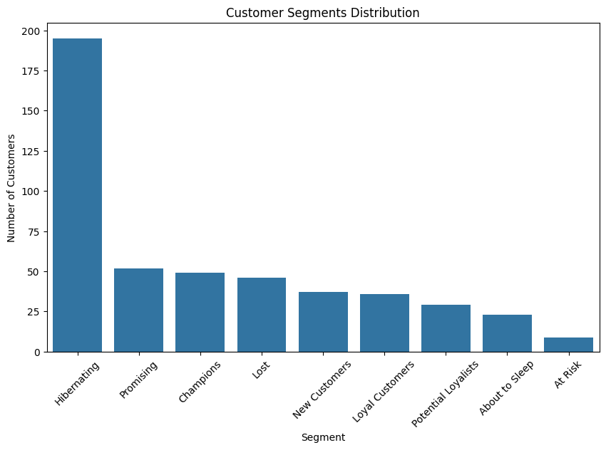

# RFM-сегментация клиентов

Сегментация клиентов розничного магазина по **давности, частоте и сумме покупок (RFM)** на Python и рекомендации по работе с каждым сегментом.

🇬🇧 [English version](README.md)

## Описание

Клиенты неодинаково ценны, и одна и та же рассылка для всех тратит бюджет впустую. RFM-анализ группирует клиентов по истории покупок:

- **Recency (R)** – сколько дней назад была последняя покупка
- **Frequency (F)** – сколько покупок сделал клиент
- **Monetary (M)** – сколько денег клиент потратил суммарно

В проекте 476 клиентов оцениваются по трём метрикам, делятся на **9 сегментов**, и для каждого сегмента предложено конкретное действие (удержание, допродажа, возврат и т.д.).

## Результаты



| Сегмент | Клиентов | Доля | Рекомендация |
|---|---:|---:|---|
| Hibernating (спящие) | 195 | 41.0% | Недорогие автоматические рассылки со скидками на популярные товары |
| Promising (перспективные) | 52 | 10.9% | Наборы товаров, аксессуары, порог бесплатной доставки |
| Champions (чемпионы) | 49 | 10.3% | VIP-статус, приоритетный сервис, ранний доступ (без прямых скидок) |
| Lost (потерянные) | 46 | 9.7% | Одна финальная кампания, затем убрать из активной CRM |
| New Customers (новые) | 37 | 7.8% | Приветственные письма, промокод на второй заказ |
| Loyal Customers (лояльные) | 36 | 7.6% | Кросс-продажи, многоуровневая программа лояльности |
| Potential Loyalists | 29 | 6.1% | Подписки, допродажи премиум-категорий, купоны с ограниченным сроком |
| About to Sleep | 23 | 4.8% | Персональные подборки, опрос удовлетворённости, напоминания о сгорании бонусов |
| At Risk (в зоне риска) | 9 | 1.9% | Сильные предложения для возврата, звонок менеджера |

## Данные

[Retail Sales Dataset](https://www.kaggle.com/datasets/mohammadtalib786/retail-sales-dataset) с Kaggle: 1000 транзакций, 9 столбцов (ID транзакции, дата, ID клиента, пол, возраст, категория товара, количество, цена за единицу, сумма). Период: 2023 год по 2024-01-01.

> ⚠️ **Важно.** В исходных данных у каждого клиента ровно одна покупка, поэтому RFM на них не работает. Чтобы смоделировать повторные покупки, я случайным образом переназначил ID клиентов (`np.random.seed(42)`, ID от 0 до 599, получилось 476 уникальных клиентов). Поэтому **размеры сегментов иллюстративны: проект демонстрирует метод, а не реальные бизнес-выводы.** Пол и возраст не менялись и в анализе не используются.

## Методология

1. **Предобработка** – названия столбцов в snake_case, преобразование дат, имитация повторных покупок.
2. **Опорная дата** – последняя дата транзакции в данных.
3. **Таблица по клиентам** – Recency, Frequency, Monetary (`groupby` + `agg`).
4. **Оценки** – квартильные баллы от 1 до 4 по каждой метрике (для Recency чем меньше дней, тем выше балл).
5. **RFM-класс** – три балла объединяются в код, например `443`.
6. **Сегментация** – RFM-классы сопоставляются с 9 бизнес-сегментами по правилам (`np.select`).
7. **Визуализация и рекомендации** – распределение сегментов и план действий.

## Стек

Python · pandas · NumPy · Matplotlib · Seaborn · Jupyter Notebook · kagglehub

## Запуск

```bash
git clone https://github.com/<USERNAME>/rfm-customer-segmentation.git
cd rfm-customer-segmentation
pip install -r requirements.txt
jupyter notebook RFM_Customer_Segmentation.ipynb
```

Датасет скачивается автоматически через `kagglehub` (может понадобиться бесплатный аккаунт Kaggle). Ноутбук также можно открыть в Google Colab.

## Ограничения и дальнейшие шаги

- Повторные покупки смоделированы, поэтому метод стоит проверить на реальных транзакциях (например, Online Retail II).
- Границы квартилей посчитаны на небольшой выборке; на больших данных могут подойти квинтили или бизнес-пороги.
- Возможное расширение: сравнить RFM-сегменты с кластеризацией K-Means и сделать дашборд в Power BI.

## Автор
 
[GitHub](https://github.com/dreamkeeperx)
